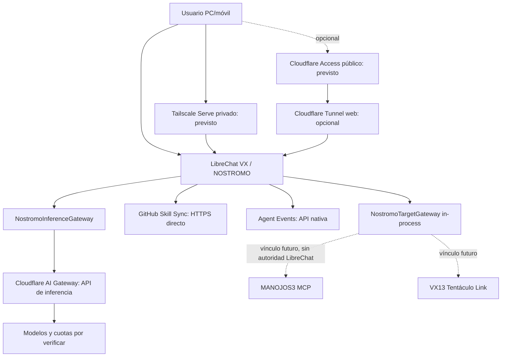

# LibreChat VX / NOSTROMO — explicación derivada del paquete canónico

**Fecha de corte:** 2026-10-08. **Paquete:** tres archivos, en esta misma carpeta: `SPEC.json` (única especificación funcional y configuración), `TOPOLOGY.json` (inventario único de recursos/conexiones) y este `EXPLICACION.md` (lectura humana, sin copiar JSON).

**Fuente SOURCE:** `elkakas314/libre_chat_vx@94954512312ce2b1b478c1bc19c3d01c5b52b2d2` (rama `handoff_current_bootstrps`). CI exacto [37726226657](https://github.com/elkakas314/libre_chat_vx/actions/runs/37726226657): **SUCCESS, 117/117 tests, overlay-smoke SUCCESS**. Estos datos son prueba de SOURCE/CI, no un despliegue en el Lenovo.

## 1. Arquitectura y autoridad

NOSTROMO es la cabina de conversación, intención, investigación y presentación. Conserva una sola identidad y proyecta, en lectura, la verdad de sistemas externos. No reimplementa la autoridad de MANOJOS3 ni VX13: `SPEC.json#/arquitectura`, `SPEC.json#/seguridad` y `SPEC.json#/integraciones`. `AUTO/BOTH` son alcances de visualización, no autorizaciones materiales. Un target concreto ejecuta por su propia ruta gobernada con readback/receipt.



Los 13 recursos, 15 enlaces y siete rutas semánticas se consultan **solo** en `TOPOLOGY.json#/recursos`, `TOPOLOGY.json#/enlaces`, `TOPOLOGY.json#/rutas_inferencia`. Los valores de variables y su clasificación están **solo** en `SPEC.json#/configuracion/env`. La topología usa referencias lógicas; no mantiene otra lista con definiciones de variables.

## 2. Estados: SOURCE no es LIVE

Un enum **único** para despliegue/runtime: `SPEC.json#/meta/estado_runtime_enum`.

| Estado runtime | Uso exacto |
|---|---|
| `NO_DEPLOYMENT_EVIDENCE` | No hay observación LIVE del host/cuenta; **no afirma** que esté apagado o ausente. |
| `NOT_DEPLOYED` | Ausencia confirmada por inspección real del recurso correcto. |
| `DEPLOYED_UNVERIFIED` | Existencia confirmada pero falta health/canary completo. |
| `LIVE_VERIFIED` | Servicio/ruta probado con observación fresca, permisos y alcance. |
| `MATERIAL_VERIFIED` | Efecto target validado con readback, Verifier y Receipt. |

Los campos `estado_gate` son el ciclo de pendientes; los campos `estado_source_declarado` o `declaracion_documental_previa` preservan afirmaciones históricas **no verificadas**. No deben confundirse con el estado runtime. **No hay en este hilo un readback autenticado de Cloudflare ni del Lenovo**: los recursos inventariados conservan `NO_DEPLOYMENT_EVIDENCE`.

## 3. Canales de transporte: cinco funciones distintas

**Local:** servidor LibreChat previsto en `127.0.0.1:3080`. La dirección es un objetivo de configuración, no un hecho LIVE. Referencias `TOPOLOGY.json#/recursos` id `lc-local-web` y `SPEC.json#/despliegue`.

**Privado:** Tailscale Serve para PC/móvil autorizado por tailnet + ACL; nunca Funnel como opción de base, y sin tocar la instancia MANOJOS3. La política Tailscale y la sesión LibreChat son controles independientes. Requiere observar Serve actual, salud local y revocación antes de promover: `lc-tailserve`.

**Público, opcional:** Cloudflare Tunnel para web, siempre detrás de Cloudflare Access y con identidad propia, sin reutilizar túneles, hostname o credenciales de MANOJOS3. No es requisito de la inferencia: `lc-cf-web`, `lc-cf-access`.

**Cognitivo:** Cloudflare AI Gateway es salida HTTPS de inferencia, **no un túnel web**. Siete rutas `dynamic/nostromo-*`, solo modelos con cuota real y coste cero acreditados; no fallback de pago: `lc-aig` y `TOPOLOGY.json#/rutas_inferencia`.

**Distribución/eventos/recovery:** GitHub Skill Sync va por HTTPS directo; Agent Events es una superficie autenticada de la app; Tailscale SSH sería recuperación administrativa independiente. Ninguno concede autorización a los targets.

## 4. Variables: único catálogo

Las **21 entradas consolidadas** están en `SPEC.json#/configuracion/env`, con `nombre`, `capa`, sensibilidad, condición de obligatoriedad y `valor=null`. Se añadieron tres variables de Cloudflare Tunnel ausentes en la antigua spec y tres variables opcionales de Keenable respaldadas por documentación. No se han copiado credenciales, valores del `.env` ni datos del equipo. Para Cloudflare Tunnel se elige **modo remoto con token** o **modo local con identificador/archivo**; no combinarlos automáticamente.

**Conflicto real sin decisión falsa:** el ejemplo anterior de Skill Sync usa `librechat-vx-skills` y el canario nuevo usa `nostromo-vx-skills`. La especificación lo marca en `SPEC.json#/configuracion/librechat_yaml/skill_sync_id_canonicalizacion`; solo se decide tras leer el admin real. No cambies el source ID de un mirror activo por inferencia.

## 5. Keenable confirmado, funcionamiento LIVE pendiente

`searchProvider: keenable` y `scraperProvider: keenable` son nombres **válidos** para LibreChat, no un typo: aparecen en la [configuración oficial del upstream fijado](https://github.com/LibreChat-AI/LibreChat/blob/f10b1d91f1eee3a2c82d5247bf620351486b7c1b/librechat.example.yaml) y en [la documentación de Web Search](https://www.librechat.ai/docs/features/web_search). El modo sin clave es posible con límites públicos; si se precisa mayor cuota hay clave opcional. **No se ha realizado canario de webSearch desde el host**. La config queda SOURCE-confirmada y el gate LIVE sigue abierto.

## 6. Bloqueadores y acciones concretas

El primero es `LC-CF-AIG-BINDING`, registrado en `TOPOLOGY.json#/gates_live` y `SPEC.json#/backlog`: se necesita lectura autenticada de cuenta/gateway, las siete rutas, providers/fallbacks, coste/cuota por cuenta, un canario sin gasto y rollback verificable. **Un repositorio GitHub no puede demostrar ni suplir estas pruebas.** En este hilo no hay un conector Cloudflare de cuenta habilitado ni sesión SSH de host; por tanto el gate permanece abierto, sin comandos ejecutados en el Lenovo ni secretos extraídos. No inventar PASS.

Después siguen el canario de Skill Sync (primero 12 Skills físicas, después 10 activas sin borrar alias), el acceso móvil Tailscale, Web Research, Agent Events y recovery. La regla de continuidad permite trabajar en SOURCE independiente sin saltarse gates; no significa servicios asíncronos.

## 7. Cómo validar el paquete sin duplicación

```bash
jq empty SPEC.json && jq empty TOPOLOGY.json
node -e "for (const f of ['SPEC.json','TOPOLOGY.json']) JSON.parse(require('fs').readFileSync(f,'utf8'))"
```

Para generar un diff reproducible se usa `jq -S .` y codificación UTF-8. Referencias con `$ref` son **referencias documentales lógicas**, no resolución automática por un validador JSON Schema. Los dos JSON se distribuyen juntos, con rutas relativas. Los archivos históricos siguen accesibles mediante enlaces previos, pero **no forman parte del paquete canónico** ni deben editarse para nuevos cambios.

## 8. Fuentes canónicas vigentes

- SOURCE/CURRENT: https://github.com/elkakas314/libre_chat_vx/blob/94954512312ce2b1b478c1bc19c3d01c5b52b2d2/CURRENT.json
- Topología SOURCE: https://github.com/elkakas314/libre_chat_vx/blob/94954512312ce2b1b478c1bc19c3d01c5b52b2d2/config/parallel_transport.current.json
- Inventario SOURCE: https://github.com/elkakas314/libre_chat_vx/blob/94954512312ce2b1b478c1bc19c3d01c5b52b2d2/config/transport_registry.current.json
- Priorización: https://github.com/elkakas314/libre_chat_vx/blob/94954512312ce2b1b478c1bc19c3d01c5b52b2d2/operating/GAPS_CURRENT.json
- Política local: `SPEC.json#/seguridad` y topología `TOPOLOGY.json#/continuidad_seguridad`.
