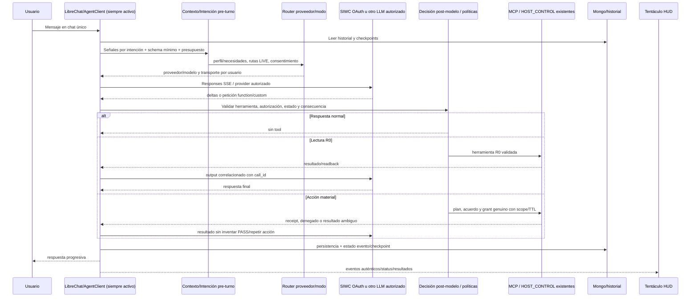

# NOSTROMO — Dictamen sobre DeepSeek A–H y plan ejecutable corregido (18-11-2026)

> **Estado de este documento:** REVIEWED_PROPOSAL / SOURCE_VERIFIED_PARTIALLY / HOST_NOT_AUDITED. No es un nuevo `CURRENT`, no es una implantación, no autoriza grants ni reemplaza SPEC/TOPOLOGY. **No fusionar por defecto ni usar para forzar el Work activo**. Informe DeepSeek proporcionado por propietario; validado contra repositorios, CI y docs oficiales. Corte NOSTROMO `integration/nostromo-canon-20261118-r1@6f205d8a2a8cae833a5a0fa3ac6b30d6a641674a`; upstream `LibreChat-AI/LibreChat@f10b1d91f1eee3a2c82d5247bf620351486b7c1b` y SDK `@librechat/agents@4.0.1`. HEAD puede avanzar: comprobarlo siempre.

## Decisión de aceptación

**ADOPTAR SOLO COMO HIPÓTESIS DE ARQUITECTURA** el concepto: LibreChat/AgentClient único + selección de modelo SIWC/otras rutas + intención/decisión como responsabilidad distinta + memoria/versionado + tools MCP/HOST_CONTROL existentes + HUD observador nativo + consolidación reversible. DeepSeek no entregó patches aplicables completos, ni mapa de autoridad/readback completo, ni evidencia del host. Hay errores verificables en test visual, YAML, orden de migración, ubicación y mecanismo SIWC.

### Evidencia de GitHub, no del Lenovo

- Rama E3 exacta `6f205d8`, PR #54 DRAFT. `source-check` [run 44364160187](https://github.com/elkakas314/libre_chat_vx/actions/runs/44364160187) **SUCCESS (6/6 jobs)**. `nostromo-native-runtime-ci-canary` [run 44364160206](https://github.com/elkakas314/libre_chat_vx/actions/runs/44364160206) **FAILURE** en mock desktop/mobile `e2e/screenshots/vx-prereq.spec.ts:104`. No confundir GREEN SOURCE con E2E HOST.
- `overlay/upstream/VXCockpitBridge.tsx:58-66` muestra `<h3>Estado de la conversación</h3>` **fuera** del condicional de `activeMode==='AUTONOMO'`. `ci/fixtures/native-overlay-prereq.spec.ts:102-114` exige `toHaveCount(0)` al activar VX13 y que vuelva al regresar. El código actual hace global el encabezado de actividad del chat. **La corrección preferida es cambiar el test para esperar encabezado global presente y verificar que sí cambian los elementos propios del sistema activo**, salvo que un requisito UI confirmado demande lo contrario. No aplicar el parche hipotético `activeTab !== 'vx13'` de DeepSeek para hacer pasar la prueba. No renombrar encabezado global sin especificación.
- `packages/data-provider/src/config.ts` del **upstream pin** define `toolApprovalPolicySchema` con claves `enabled`, `mode`, `allow:string[]`, `deny:string[]`, `ask:string[]`, `reason`, `hooks`; **NO** define `rules:[{match,action}]`. El YAML del informe DeepSeek es incompatible. La semántica del SDK aplica `deny > ask > allow`, con host grant/target policy independiente. Un ejemplo correcto de forma (NOMBRES DE TOOLS SOLO ILUSTRATIVOS, **NO APLICAR SIN R0**):
```yaml
endpoints:
  agents:
    toolApproval:
      enabled: true
      mode: default
      allow:
        - "mcp:servidor-real:lectura_*"
      ask:
        - "mcp:servidor-real:escritura_*"
      deny:
        - "mcp:servidor-real:destructiva_*"
```
- `packages/api/src/agents/initialize.ts` SÍ EXISTE en upstream pin, pero el hook que Work ha parcheado es **`api/server/services/Endpoints/agents/initialize.js`**. Dejar explicitado ese alcance; no sustituir erróneamente el dueño del modelo por un nuevo provider registry. `deployment/librechat-agents/agentclient-siwc-binding.mjs` exige anclas y `BASE_SHA256`; por ahora modo `NOSTROMO_CI_EPHEMERAL_STAGE=1`, parche reversible en checkout CI desechable. **No hay aplicación HOST ni consentimiento SIWC probado.**
- SIWC existente `src/llm/{chatgptAuthorized,siwcLoopback,siwcIdentity,siwcSession,siwcProtectedVault,siwcConnectionService,siwcProviderRoutes,siwcOpenAiFetch,siwcResponsesClient}.ts`. `siwcOpenAiFetch.ts` resuelve credenciales por userId y fabrica transporte `fetch` para endpoint `openAI` del mismo AgentClient, con `useResponsesApi:true` y `store:false,stream:true` obligatorios. **No crear clase `SiwcProviderBinding` ficticia ni provider completamente nuevo porque DeepSeek lo dibuje**; verificar compatibilidad SDK real del fetch y tool calls. No reescribir OAuth ya existente.
- Restricciones SIWC preview oficiales: **no hosted Responses `tool_search`**, no MCP hospedado, computer use nativo, code interpreter ni file_search. Solo herramientas `function/custom` admitidas, namespaced o `additional_tools`, ejecutadas por LibreChat/MCP host con comprobación ACL/estado. **Carga diferida nativa LibreChat no autoriza usar Responses tool_search con SIWC.** Contrato: https://developers.openai.com/siwc/token-sharing-open-source/preview-limitations .
- `src/llm/siwcProviderRoutes.ts` clasifica `SUBSCRIPTION_SHARED` con consentimiento, NO `VERIFIED_ZERO_COST`; Plan ChatGPT Plus tiene cuota compartida. Ningún fallo puede seleccionar fallback facturable.
- `src/librechat/nativeInferenceRouteAdapter.ts` llama `interpretIntent` y `bridgeIntentToDecision`; `toolCallingRequired` basado en herramientas seleccionadas puede forzar `needsResearch`. Test negativo `Hola` + 11 herramientas Builder seleccionadas debe admitir diálogo sin perfilar `INVESTIGAR` artificialmente; distinguir catálogo, capacidad y tools realmente presentadas al modelo. Model router **admite** la ruta, no ejecuta R2.
- LibreChat `summarization.reserveRatio:0.05` es **headroom del mecanismo de resumen**, no presupuesto universal de salida: hay que reservar **por separado** respuesta y herramientas. El umbral `token_ratio:0.8` es ejemplo, NO seguro que esté configurado. El `contextPruning.enabled` por defecto es `false`; usa soft/hard para resultados GRANDES; no aplicar truncación arbitraria `head+tail 300 chars` a evidencia/receipts. Referencia: https://www.librechat.ai/docs/configuration/librechat_yaml/object_structure/summarization , pero confirmar campos y comportamiento en upstream pinned y YAML efectivo.
- Propuesta DeepSeek de archivar `~/librechat/upstream` **RECHAZADA**: es backend LIVE según Work; `~/librechat/nostromo` es herramientas/reports/backups y worktrees, NO backend canónico según receipt. `~/libre_chat_vx-clean` alimenta MCP live y contiene deltas únicos; `~/LibreChat` (mayúscula) tiene Compose/volúmenes de Mongo, Meili y RAG **KEEP_ACTIVE_DATA**. `~/librechat/vx` fue reportado ausente (verificar). `~/upstream` UNKNOWN_PRESERVE hasta semdiff. No convertir `git diff` entre proyectos de ramas diferentes en prueba de duplicación. Rutas HOST_REPORTED, no revalidadas por esta auditoría.

## Flujo canónico en términos humanos y runtime (no duplicar router)



**NOSTROMO** es la identidad/contratos/orquestación dentro del AgentClient, no un segundo servidor de conversación. **Tentáculo HUD** se suscribe a eventos y receipts dentro del panel nativo, no autoriza ni decide. **Memoria de ChatGPT no llega a LibreChat por SIWC**; persistencia Mongo y retrieval son locales.

## Plan de implementación corregido y atómico

No convertir las fases en prerequisitos lineales innecesarios: ramas de CI, OAuth SOURCE, readback host y compilación pueden progresar independientemente. Un único escritor material para `integration`.

| Fase | Dependencia / readback | WRITE-SET SOURCE propuesto | Prueba/gate / rollback |
|---|---|---|---|
| **P0 — CI visual específica** | HEAD actual; `ci/fixtures/native-overlay-prereq.spec.ts:104`; comprobar UI global vs modal | **Solo test fixture** si intención UI confirma encabezado global; preservar bridge | Mock desktop+mobile, comprobar a la vez `aria-pressed`, `tentaculo-focus` y ausencia del hub; CI native exact HEAD. Rollback `git revert`. |
| **P1 — SIWC Auth+AgentClient SOURCE** | Reconciliar código ya escrito E3 con HEAD; upstream pinned y SDK exports | Reutilizar `siwcConnectionService.ts`, `siwcOpenAiFetch.ts`, `agentclient-siwc-binding.mjs`, wiring server-only existente. No nuevo provider | TS tests, mocks de identidad/account aislamiento/refresh, upstream CI SDK streaming SSE final; no toolSearch en body; no tokens al frontend. Si falla, revert commit exacto. |
| **P2 — Contexto pre-turno + tools por fase** | Medir prompt + tool schema/IDs + ventana real del proveedor; misma identidad Builder | Modificar solo ensamblaje del turno y `nativeInferenceRouteAdapter` si test prueba defecto; usar `intentInterpreter`, `nostromoDecisionBridge`. Ajustar configuration native para compaction | Tests `Hola` tool catalog 11 -> 0 tools in prompt; tarea R0 -> schema R0; P0 tool calls SIWC stub; `system + selected_tools + memory + recent + output_reserve <= window`. Sin Qwen forzado. |
| **P3 — Readback mínimo HOST sin daño** | Datos exactos faltantes: effective YAML, env override presence-only, Mongo Builder model/tools, Docker mounts, PID cwd/exe, checkout git dirty | **NINGUNO**; actas sanitizadas en reports privados/handoff | No imprimir secretos/mensajes; state SOURCE vs LIVE; clasificar blobs únicos. No escanear `manojos_3` ni TODO HOME. |
| **P4 — Deploy reversible de SOURCE listo** | P0-P2 CI exact-head + preimage hashes + worktree/active services; HOST grant de cambios/restart | Overlay mínimo en upstream realmente activo mediante reconciliador CAS; no reemplazar checkout completo, no mutar Mongo en caliente | Tests stage, readback de import/hook y unidad, restauración local de preimágenes; si autorización HOST ausente detener SOLO despliegue. |
| **P5 — SIWC OAuth y canario real** | Login+consent humano vía browser oficial, modelo visible por /models, cuota, scope, USER binding, licencia respetada | Solo configuración/sesión privada por usuario mediante UI; **no API key cobrada** | 2 turnos SSE completados, recarga conserva chat Mongo, Ollama sin inferir, TTFT/CPU/RAM; fallo por 429/refresh/revoke controlado. |
| **P6 — Memoria + Tool-call R0** | P5 operativo o proveedor gratuito LIVE y compatibilidad tools readback | `memory`/summarization/permissions según YAML efectivo, checkpoints y schemas tools locales permitidas; no hosted MCP | Conversación larga + recuperación selectiva + tool `nostromo_estado` con call_id/output/receipt; sin reintentos si `UNKNOWN_OUTCOME`. |
| **P7 — Autonomía material gobernada + HUD** | P6 calls R0 PASS + permisos host existentes | Única capa `targetGateway`, planes/acuerdos, paneles Native/HUD alimentados por eventos reales; sin autoridad propia HUD | Mutación reversible con grant aplicable + readback, reinicio conversacional, dashboard sin eventos mock, una única instancia. |
| **P8 — Consolidación física de carpetas** | P5/P6 PASS, inventory host R0 completo, backup/restauración probado, consumidores PID/mounts | Fuente Git única y paths compatibles; rescatar SEMDIFF exclusivos de `vx-clean`; **NO mover datos Docker / backend hasta cutover seguro** | Diff hashes, checks de consumidores+Compose/DB, per-root disposition `KEEP/ARCHIVE_PROVEN/QUARANTINE`, rollback y prueba de continuidad. |
| **P9 — Reinicio PC por actualizaciones** | Checkpoint Git/DB/estado, reinicio requerido comprobado, acceso remoto al boot confirmado, autorización host exacta | Solo operación reboot bajo HOST_CONTROL/recovery; backup reciente y reinicio ordenado | `boot_id` nuevo, Tailscale, LibreChat, Docker/Mongo, MCP, Git dirty preserved, chat recuperable. No prometer reanudación automática de Work. |

**Orden preferente P0+P1 en SOURCE, P2 en paralelo, P3 como preflight acotado cuando se prepare P4; P5 antes de mover raíces.** Si P5 necesita consent, continuar P2/P7 SOURCE y P8 inventario R0 sin tocar datos. Si el usuario ya está listo para reiniciar antes, hacerlo SOLO tras checkpoint y recuperación probados, independiente de migración física.

### Handoff CLI mínimo para Work (NO ejecutar desde este informe)

```bash
set -euo pipefail
set +x
R='elkakas314/libre_chat_vx'
BR='integration/nostromo-canon-20261118-r1'
gh auth status
REMOTE="$(gh api "repos/$R/git/ref/heads/$BR" --jq '.object.sha')"
printf 'REMOTE_HEAD=%s\n' "$REMOTE"
# En el checkout que Work compruebe y que NO alimenta un proceso ACTIVE:
# git rev-parse HEAD
# git status --porcelain=v1 -uall
# git diff --check
# Guardar dirty/untracked con manifest SHA/copia no destructiva ANTES de actualizar.
# Crear worktree aislado sobre REMOTE (no usar git reset/clean ni force push).
# Cada lote CHANGE→TEST→READBACK→VERIFY, commit y push fast-forward normal.
# GitHub PAT fine-grained NO concede HOST_CONTROL ni OAuth SIWC.
```

## Decisión sobre Work: continuar vs nuevo objetivo

**Continuar E3** si sigue disponible, tiene worktree limpio o cambios preservados, HEAD reconciliable, conectores HOST/gh y progreso SIWC recuperable; evita recrear rutas y descubrimiento. **Work nuevo** solo si E3 está inutilizable/sin estado o su ejecución estancada no produce cambios materiales tras una fase definida; antes exportar `CURRENT/handoff/HEAD/receipts` autosuficientes, y parar el escritor anterior. La PR #54 sigue DRAFT hasta E2E material.

## Contrato de aceptación final

- SOURCE: TS tests + fixture de OAuth SSE + validaciones de body de SIWC; CI nativa + `source-check` **misma SHA**.
- HOST: readback de configuración efectiva y Mongo Agent Builder (sin secretos), modelo SIWC consentido, `response.completed` y token/account scope adecuados, misma conversación tras recargar, memoria histórica conservada.
- MCP: un tool-call real con ID, output y receipt; texto del LLM no vale; ninguna mutación sin autorización válida.
- UI: el mismo chat, cabina/HUD muestran estado vivo sin sustituir SIDE_PANEL nativo y sin duplicar kernel/servicios.
- Host/autonomía: un cambio reversible legítimo verificado, recursos medidos, sin saturación local; retomabilidad tras reinicio comprobada si se realiza.
- Root: tablas físicas origen→destino, consumidor y volúmenes Docker preservados, backups restaurables y prueba de rollback. **Prohibido PASS por documento, PR o build solamente.**

## Fuentes precisas

1. `overlay/upstream/VXCockpitBridge.tsx:45-106`, `ci/fixtures/native-overlay-prereq.spec.ts:98-115` en `6f205d8`.
2. `packages/data-provider/src/config.ts:1012-1076`, `api/server/services/Endpoints/agents/initialize.js` en upstream pinned.
3. `src/llm/siwcOpenAiFetch.ts`, `src/librechat/nativeInferenceRouteAdapter.ts`, `deployment/librechat-agents/agentclient-siwc-binding.mjs` en `6f205d8`.
4. `docs/NOSTROMO_FEATURE_MATRIX_CURRENT.md`, `docs/NOSTROMO_COCKPIT_ADVANCED_VIEWER_WORK_GATE_20261118.md`, `docs/NOSTROMO_INTEGRATION_CANON_20261118.md` en fuente.
5. Docs oficiales: https://www.librechat.ai/docs/configuration/librechat_yaml/object_structure/summarization ; https://www.librechat.ai/docs/configuration/librechat_yaml/object_structure/agents ; https://developers.openai.com/siwc/token-sharing-open-source/preview-limitations .
6. Receipts host anteriores: issue #37 y issue #56. Rutas actualizadas se consideran HOST_REPORTED hasta R0 nuevo.
