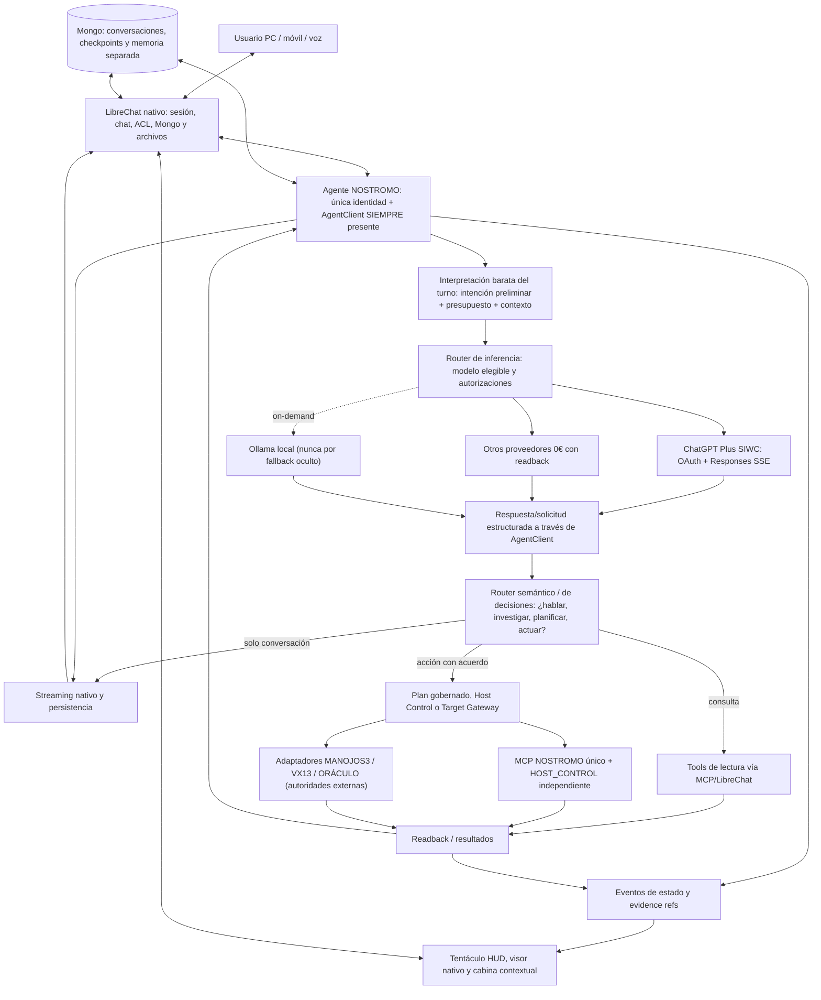
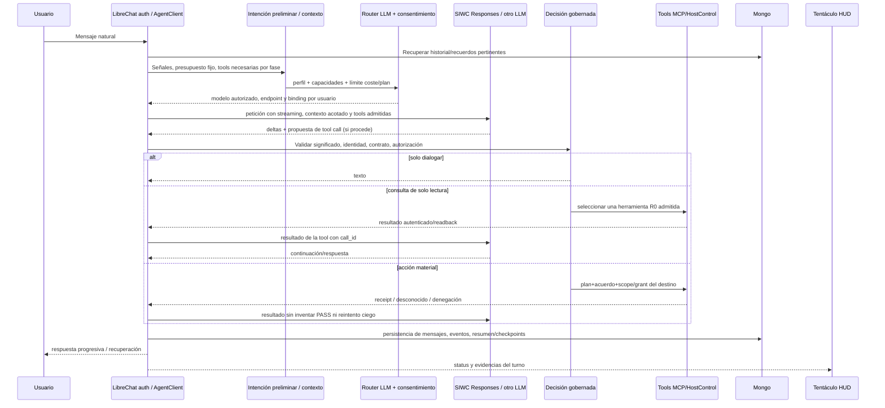

# DEEPSEEK — START HERE: auditoría arquitectónica NOSTROMO / LibreChat VX

**Fecha de corte:** 2026-11-18. **Repo público:** [elkakas314/libre_chat_vx](https://github.com/elkakas314/libre_chat_vx). **Base SOURCE congelada para el análisis:** [`6f205d8a2a8cae833a5a0fa3ac6b30d6a641674a`](https://github.com/elkakas314/libre_chat_vx/tree/6f205d8a2a8cae833a5a0fa3ac6b30d6a641674a) de `integration/nostromo-canon-20261118-r1`, PR [#54](https://github.com/elkakas314/libre_chat_vx/pull/54) DRAFT. La rama `research/deepseek-nostromo-architecture-20261118` contiene SOLO documentos de investigación y no debe ser tratada como checkout LIVE ni fundirse mientras Work E3 modifica la rama de integración.

**Lee este índice y después [mapa de componentes y raíces](DEEPSEEK_COMPONENTES_Y_RAICES_20261118.md) y [contrato de salida/aceptación](DEEPSEEK_CONTRATO_AUDITORIA_Y_PLAN_20261118.md).** El contenido de estos tres documentos es un brief preparado para auditoría externa: **INTENT + SOURCE referenciada + HOST_REPORTED**, no una nueva decisión canónica implantada. **Investiga, cuestiona y corrige técnicamente** las propuestas, pero siempre citando archivos/commit y documentación oficial.

## Misión del usuario

Diseñar un **NOSTROMO único** (LibreChat nativo + capa VX + agente, no dos chats ni dos agentes visibles) con conversación natural fluida y duradera, idealmente **ChatGPT Plus vía Sign in with ChatGPT (SIWC OAuth)** y proveedores externos realmente gratuitos; modelo Ollama local opcional y solo bajo demanda; memoria persistente selectiva; router de modelos y router semántico/de decisiones **distintos**; herramientas MCP, automatización en el PC Lenovo y proyectos externos; visor/cabina `Tentáculo HUD` que acompañe el diálogo. El usuario quiere autonomía alta y control integral de su propio PC mediante superficies HOST_CONTROL/MCP existentes, con guardas reales, readback y evidencia, no bloqueos artificiales ni un segundo Kernel. **No cobrar por API ni caer por defecto a modelos de pago.** CPU/RAM/VRAM bajos y rendimiento medido en lugar de promesas.

**Problema de hoy:** hubo turnos Qwen3 sin respuesta, ventanas efectivas 2048/6144, prompts/tools >92% de 5800 tokens en chats nuevos, ausencia de tool calls, dos filas de assistant vacías, rutas cloud SOURCE no enlazadas al AgentClient. Node 24.21 + filtro deferred SDK ya instalados en Lenovo según receipts; no repetir como problema abierto. Work desarrolla SIWC ahora, no reimplementarlo.

## Grafo funcional (experiencia del usuario; NO secuencia literal de objetos de ejecución)

### Distinción técnica esencial: quién llama a quién

El diagrama anterior es una **proyección UX**. No significa que LibreChat invoque a ChatGPT *fuera* del AgentClient y cree un agente distinto después. Para el **pipeline ejecutable**, el `AgentClient` nativo es el conductor del turno desde el principio: autentica usuario/Builder, prepara la llamada y el streaming, consulta router y modelo **ANTES** de crear el cliente LLM, hace `Responses` contra SIWC o el provider admitido, valida `tool_call`, usa las herramientas locales/ACL/approval del host, alimenta resultados y persiste. El modelo puede proponer acciones, **no dispara por sí solo el MCP ni obtiene permiso material**.

Separar:
- **Router de inferencia**: *cuál LLM* según consentimiento, catálogo LIVE, ventana/capacidad, privacidad, salud, cuota, latencia, coste.
- **Router semántico/de decisiones**: *qué hacer* según intención, contexto, objetivo/plan, permisos, dependencias, resultado readback; preclasificación barata ANTES del modelo, reevaluación/validación DESPUÉS de la salida del modelo.
- **NOSTROMO/AgentClient**: única identidad y orquestación. La fase ejecutora es una capacidad condicional del mismo sistema, NO segundo agente.
- **Tentáculo HUD**: observador visual **dentro de LibreChat**, conectado a eventos y al mismo chat; no es proxy obligatorio de LLM ni una fuente de autoridad.
- **Memoria**: no es la «memoria de la cuenta ChatGPT». El historial/checkpoints viven en Mongo/LibreChat; memoria relevante se recupera de forma selectiva con cuotas y versiones.

## Secuencia técnica recomendada para inspeccionar y ajustar

**Si DeepSeek recomienda una variante más simple o rápida**, exigir compatibilidad explícita con el upstream/SDK fijados, el modelo de autorización existente y pruebas; no introducir dependencias externas permanentes para resolver un problema de cableado.

## Lo que debe arreglarse (sin suponer que SIWC borra los tokens)

1. **Primer token y preflight:** la ventana de ChatGPT SIWC puede ser mayor, pero es **finita**; no importa el historial ni memorias de ChatGPT. Calcular coste de tokens de instrucciones, schema de tools, mensajes, memoria recuperada y reserva de salida. En turnos «Hola» el schema de herramientas debe ser mínimo. Compactación + poda de resultados antiguos + recuperación con citas y relectura de originales. No almacenar un historial ilimitado en cada `input`.
2. **Binding SIWC nativo:** Work ya añadió `src/llm/siwcProviderRoutes.ts` (`SUBSCRIPTION_SHARED`, distinto de `ZERO_COST`), `src/llm/siwcConnectionService.ts`, `src/llm/siwcOpenAiFetch.ts` y `deployment/librechat-agents/agentclient-siwc-binding.mjs` para el upstream. El parche SOURCE es de **staging CI solamente**, no HOST aplicado. No duplicar ni saltarse validación/consentimiento. Confirmar modelo/cuenta/cliente del SDK **antes** de crear `ChatOpenAI`; vigilar el contexto en `api/server/services/Endpoints/agents/initialize.js`.
3. **SIWC contrato**: OAuth oficial, `POST https://api.openai.com/v1/responses`, `store:false`, `stream:true`, historia explícita `input`, sin `previous_response_id` HTTP, `system` explícito no admitido en input, validación de modelo por cuenta, renovación. `tool_search`, hosted MCP, Code Interpreter y computer-use nativo **no admitidos en SIWC preview**; ejecución local por function/custom tools permitidos y MCP/HostControl propio. Distinguir quota plan compartida de tarifa API.
4. **Tools del Agent Builder:** 28 referencias persistidas históricas, 11 herramientas diferidas en preflight reciente y 0 llamadas MCP durante canarios; comprobar inventario efectivo en Mongo y qué schema llega a LLM. **No confundir herramientas habilitadas con herramientas necesarias para el turno.**
5. **Dos sistemas de memoria no son lo mismo:** `src/cockpit/shortMemory.ts` TTL para foco/UX; LibreChat `memory`/Mongo + `summarization` para largo plazo. La configuración SOURCE `config/librechat-vx.example.yaml` no asegura YAML LIVE y `.env` puede seleccionar otro archivo. Evitar memory extraction que cargue Qwen3 o API facturable por defecto.
6. **Estado de integración y CI:** en 6f205d8, PR #54 DRAFT y la canaria nativa falló; `source-check` estaba en curso al corte. Leer logs exactos, reparar el primer error real y no arrastrar fallos históricos del import `./state` o fixtures ya corregidos.
7. **Autonomía alta en PC:** inventariar operaciones terminal/archivos/servicios/navegador/repos/git permitidas y conectarlas al mismo MCP y HOST_CONTROL independiente; CLI/GitHub token solo para GitHub, grants host según plano propietario. Permisos por operación, scope y consecuencias; minimizar confirmaciones redundantes, pero nunca convertir texto del LLM en autoridad R2/R3 o desactivar seguridad material existente.
8. **Carpetas dispersas y datos activos:** no crear otra instalación «limpia» perdiendo Mongo/Meili/RAG; distinguir árbol **lógico** canónico vs ubicación física activa; rescue de blobs únicos en staging y cutover reversible por batches.

## Documentos prioritarios existentes (links fijados a la base SOURCE)

- [SPEC.json](../SPEC.json) — alcance y arquitectura; [TOPOLOGY.json](../TOPOLOGY.json) — topología/source vs LIVE.
- [SOURCE_MANIFEST.json](../SOURCE_MANIFEST.json), [CURRENT.json](../CURRENT.json), [HANDOFF_CURRENT.md](../HANDOFF_CURRENT.md).
- [Matriz funcional](NOSTROMO_FEATURE_MATRIX_CURRENT.md), [120 requisitos → ubicaciones](REQUIREMENT_LOCATION_MATRIX_CURRENT.md), [matriz de pruebas](../tests/REQUIREMENT_TEST_MATRIX.md).
- [Arquitectura](LIBRECHAT_ARCHITECTURE_CURRENT.md), [mapa de superficies nativas](../overlay/UPSTREAM_INTEGRATION_MAP.json).
- [Inventario de ubicaciones](REPO_LOCATION_INDEX_CURRENT.md), [cierre Work y limpieza](WORK_NOSTROMO_FINAL_EXECUTION_20261118.md).
- [SIWC actual](CHATGPT_SIWC_AUTHORIZED_CURRENT.md), [cabina avanzada](NOSTROMO_COCKPIT_ADVANCED_VIEWER_WORK_GATE_20261118.md).
- [GitHub issue #37](https://github.com/elkakas314/libre_chat_vx/issues/37) — receipts Work; [#55](https://github.com/elkakas314/libre_chat_vx/issues/55) — SIWC diseño; [#56](https://github.com/elkakas314/libre_chat_vx/issues/56) — inventario/carpeta/reinicio.

**Recursos oficiales a contrastar con la versión pin** (en caso de diferencia, implementar según código instalado, documentar el delta):
- OpenAI SIWC [inicio](https://developers.openai.com/siwc/quickstart), [inferencia](https://developers.openai.com/siwc/token-sharing-open-source/models-and-inference), [limitaciones](https://developers.openai.com/siwc/token-sharing-open-source/preview-limitations), [cuentas](https://developers.openai.com/siwc/token-sharing-open-source/profiles-and-sessions), [DevKit](https://github.com/openai/sign-in-with-chatgpt-devkit) (revisar licencia).
- LibreChat [Agents](https://www.librechat.ai/docs/features/agents), [memory](https://www.librechat.ai/docs/configuration/librechat_yaml/object_structure/memory), [summarization](https://www.librechat.ai/docs/configuration/librechat_yaml/object_structure/summarization), [agentes YAML](https://www.librechat.ai/docs/configuration/librechat_yaml/object_structure/agents).
- GitHub [credenciales/CLI](https://docs.github.com/en/authentication/keeping-your-account-and-data-secure/about-authentication-to-github).

## No confundir con un nuevo trabajo Work

Se pide **un informe independiente, detallado y prescriptivo** para evaluar si cerrar y reemplazar Work E3 o continuar. DeepSeek no debe ejecutar host, crear PRs, editar SOURCE ni afirmar tests PASS: **entregar especificaciones, diff sugeridos, dependencias, criterios de aceptación, orden atómico, rollback y plantillas CLI.** ChatGPT consolidará los hallazgos validados y solo después se elegirá quién escribe y ejecuta. Rutas físicas del host son HOST_REPORTED; DeepSeek no puede conocer su contenido por navegar GitHub.

**Continuar** por [DEEPSEEK_COMPONENTES_Y_RAICES_20261118.md](DEEPSEEK_COMPONENTES_Y_RAICES_20261118.md) y [DEEPSEEK_CONTRATO_AUDITORIA_Y_PLAN_20261118.md](DEEPSEEK_CONTRATO_AUDITORIA_Y_PLAN_20261118.md).
