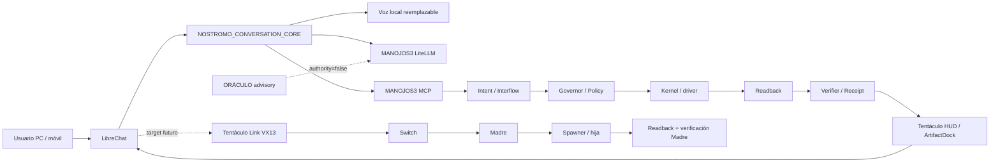
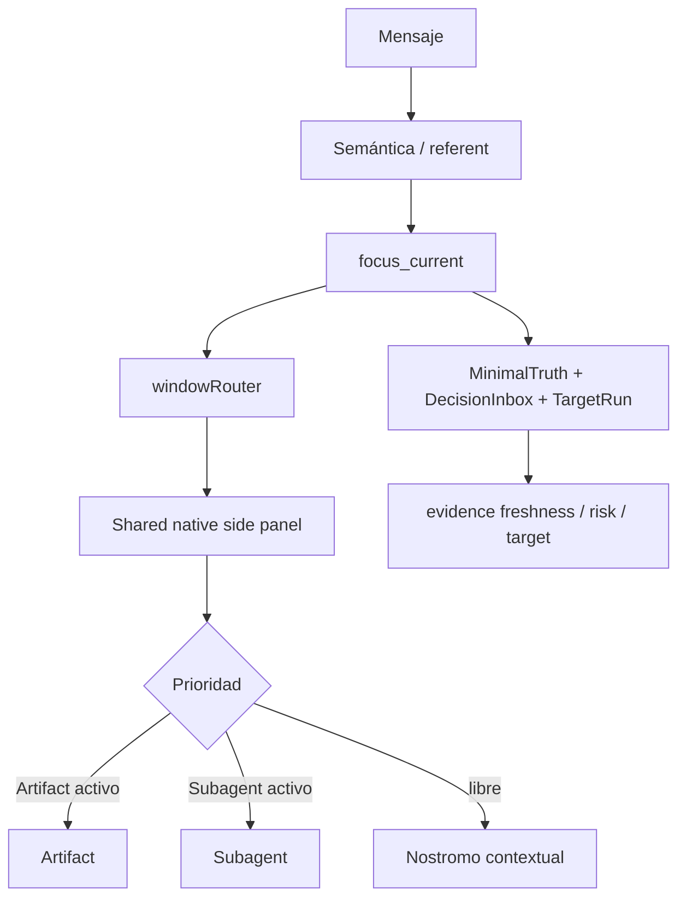
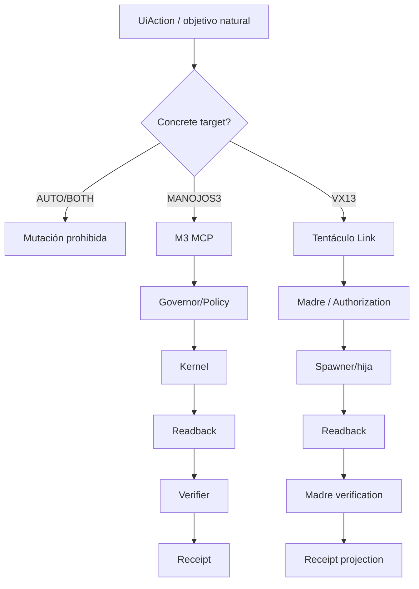
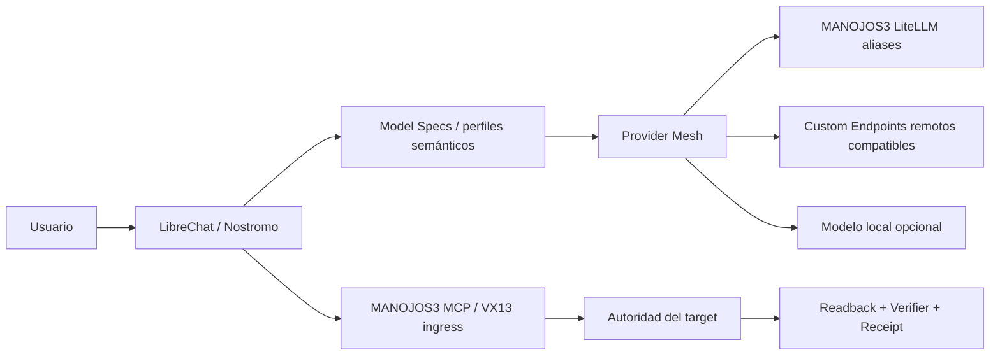
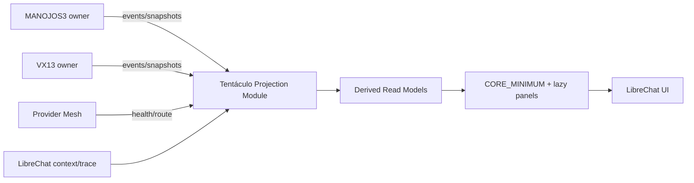
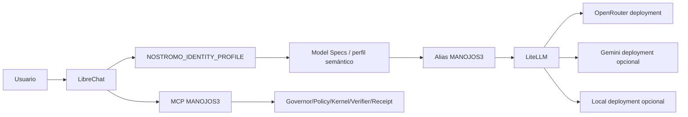
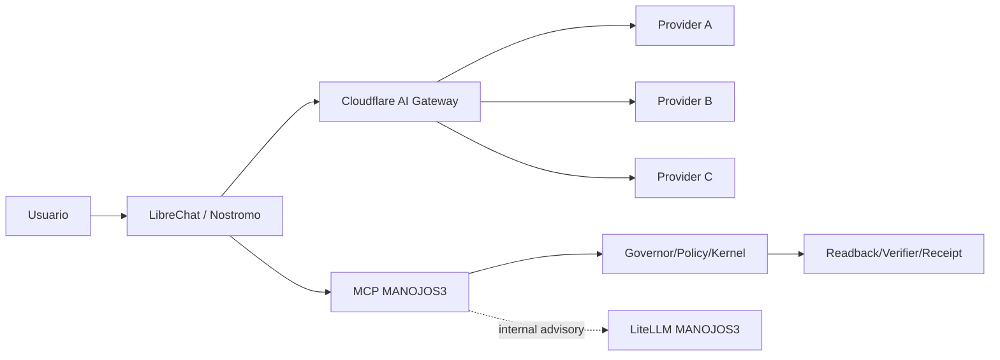
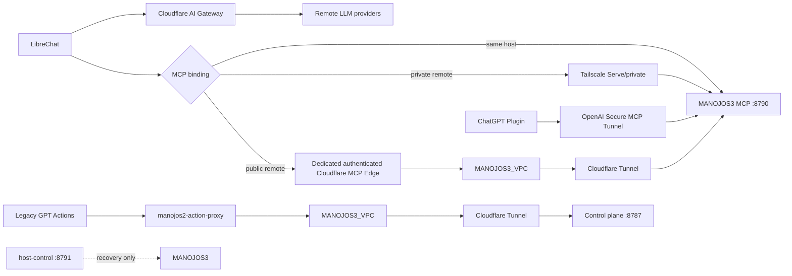

# BLUEPRINT LIBRECHAT CURRENT

## Arquitectura general



## Focus / ventana



## Mutación



## Lanes
- Conversation: lenguaje/respuesta.
- Objective/action: gobernanza/efecto.
- Projection/HUD: read models.
- Native: lifecycle UI LibreChat.
- Evidence: receipts/readback/artifacts.

## Invariantes
1. LibreChat authority=false.
2. LLM authority=false.
3. Focus != target.
4. Approval UI != target authorization.
5. BackgroundTask != TargetRun proof.
6. Resume UI != replay material.
7. Artifact != TrustedSurfaceHost.
8. `AUTO/BOTH` no mutan.
9. PASS material exige readback + verifier + receipt.
10. Polling fijo no es baseline; event-driven/lazy/backpressure/snapshot-resync.

## Provider Mesh de razonamiento



Invariantes adicionales:
11. El proveedor del LLM es intercambiable y no forma parte de la autoridad.
12. Modelo local = opcional; remoto = posible; ninguno es requisito único.
13. Model Specs/aliases son identidades semánticas; el binding real se verifica LIVE.
14. Fallover de inferencia no reenvía ni duplica acciones.
15. No existe fallback automático a proveedor de pago.

## Tentáculo HUD / Projection Plane



El Projection Module es in-process con LibreChat; no tiene authority ni truth database.

### Carriles independientes

```text
CONNECTION: UNKNOWN -> CONNECTING -> CONNECTED -> DEGRADED -> DISCONNECTED
READINESS:  UNKNOWN -> DISCOVERING -> READY | NOT_READY | DEGRADED
WORK:       IDLE -> PLANNING -> ADMITTED -> WAIT_AUTH -> QUEUED -> RUNNING -> READBACK -> VERIFYING -> SUCCEEDED | FAILED | CANCELLED | UNKNOWN_OUTCOME
EVIDENCE:   NONE -> EXPECTED -> READBACK_AVAILABLE -> VERIFIED -> RECEIPT_AVAILABLE
```

### Event contract

Cada evento proyectado incluye `event_id`, `stream_id`, `sequence`, owner/provenance, timestamps, target/run refs y payload. Duplicados se descartan; gaps marcan STALE/GAP_DETECTED; se recuperan por replay si existe o snapshot autoritativo. No se coalescen authorization/evidence/terminal transitions. Polling fijo sólo fallback.

### Provider critical path

```text
browser -> LibreChat -> ProviderRouteResolver -> selected inference route -> stream
```

Tentáculo HUD no bloquea TTFT. Health/routing usa estado cacheado/derivado y no sondea todos los proveedores por turno.

### MANOJOS3 real binding

```text
LibreChat
 -> MANOJOS3 MCP deployment URL
    -> manojos_status / capabilities / skills
    -> manojos_prepare or manojos_submit
    -> manojos_run / authorization reads
    -> resume / advance / pause / cancel
    -> manojos_receipt
 -> MANOJOS3 control plane internally
 -> Governor / Policy / Kernel / driver
 -> readback / Verifier / Receipt
```

El deployment puede traducir networking, pero no cambia el contrato ni crea tools paralelas.


## Provider profile routing / identity split



Reglas:
- `semantic alias != provider`.
- `identity != provider`.
- `prompt persona != authority`.
- `free tier != zero-cost LIVE proof`.
- `provider failover != material replay`.
- `large context != upload everything by default`.
- `multimodal inference != target evidence`.
- `structured JSON != trusted material state`.
- `local model != deployment prerequisite`.

Structured output:
```text
model JSON
 -> schema validation
 -> semantic validation
 -> target binding check
 -> MCP MANOJOS3 if material
```

Large context:
```text
targeted reads -> File Context/RAG -> compact relevant context -> long-context alias only if needed
```

Provider details shown in Tentáculo HUD are diagnostic: alias, provider/model, locality, capability flags, health, quota/rate-limit state and freshness. None changes authority.


## Cloudflare remote inference plane



Invariantes:
- Cloudflare route/model change nunca altera authority.
- LibreChat conversation path no depende de LiteLLM M3.
- LiteLLM M3 puede seguir sirviendo consumidores internos.
- no hay loop Cloudflare -> M3 LiteLLM -> Cloudflare.
- paid route no puede aparecer como fallback implícito.
- provider search/tool output no es EvidenceRef/ReceiptRef.


## Transport topology



Separación obligatoria:
- AI Gateway != Cloudflare Tunnel.
- LibreChat MCP edge != legacy Action Proxy.
- OpenAI Secure MCP Tunnel != generic LibreChat transport.
- Tailscale Funnel != baseline public MCP.
- host-control != normal action route.
